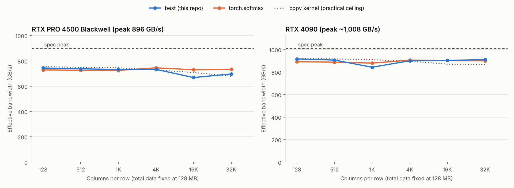
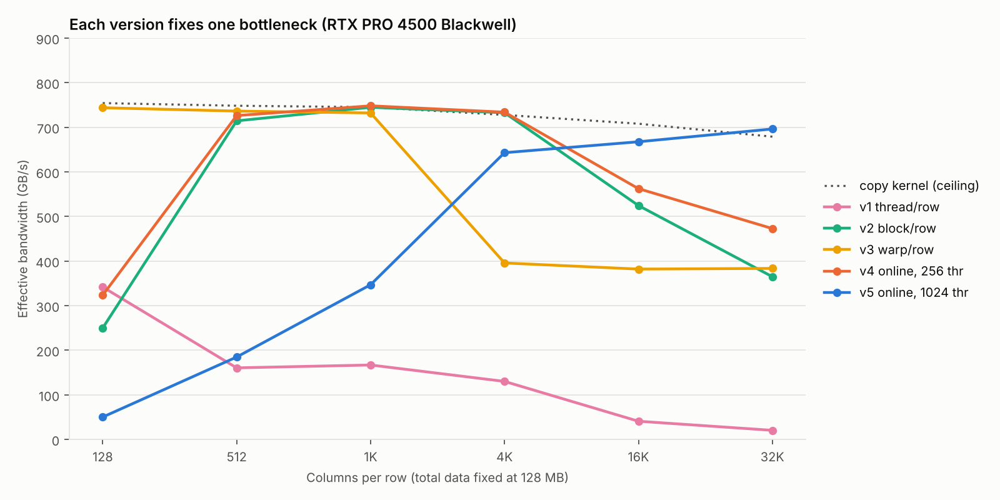

# softmax-cuda

Row-wise softmax in CUDA, optimized step by step and benchmarked against
`torch.softmax` on two GPUs. A shape-based dispatcher picks the best of five
kernels for each row width. It **matches or beats PyTorch at every width on an
RTX 4090** (about 90% of peak memory bandwidth), and beats it up to 1K columns
on an RTX PRO 4500 Blackwell.



## Results

Effective bandwidth in GB/s (higher is better). Total data is fixed at 128 MB
(2^25 floats) for every shape, so each column moves the same number of bytes.

**RTX 4090** (spec peak ~1,008 GB/s)

| Columns per row | best (this repo) | torch.softmax | best vs PyTorch |
| --- | --- | --- | --- |
| 128 | 916.6 | 892.5 | 102.7% |
| 512 | 907.1 | 888.6 | 102.1% |
| 1,024 | 843.5* | 880.3 | 95.8%* |
| 4,096 | 900.8 | 906.5 | 99.4% |
| 16,384 | 903.9 | 903.5 | 100.0% |
| 32,768 | 911.1 | 900.8 | 101.1% |

**RTX PRO 4500 Blackwell** (spec peak 896 GB/s)

| Columns per row | best (this repo) | torch.softmax | best vs PyTorch |
| --- | --- | --- | --- |
| 128 | 743.9 | 728.4 | 102.1% |
| 512 | 736.9 | 725.7 | 101.5% |
| 1,024 | 732.6* | 724.7 | 101.1%* |
| 4,096 | 733.1 | 745.0 | 98.4% |
| 16,384 | 668.3 | 729.8 | 91.6% |
| 32,768 | 696.7 | 734.0 | 94.9% |

\* Measured with the dispatcher sending 1,024-column rows to v3. On both GPUs,
v4 was faster at that width (919.5 GB/s on the 4090, 748.2 on the RTX PRO 4500),
so the dispatcher now uses v4 from 1,024 columns up.

Every kernel passes a check against a double-precision CPU reference at every
shape. Raw results are in the `results_*.csv` files.

## The kernels



| Version | Idea | What it fixed | What it exposed |
| --- | --- | --- | --- |
| v1 | One thread per row, 3 passes | Baseline | Uncoalesced reads; too few threads on wide rows (20 GB/s at 32K) |
| v2 | One block (256 threads) per row, shared-memory tree reductions | Coalesced reads, enough parallelism: up to 18× faster than v1 | Slow on narrow rows; re-reads miss cache on wide rows |
| v3 | One warp per row, warp-shuffle reductions | No block-wide barriers: 3× faster than v2 at 128 columns, beats PyTorch | Packs 8× more rows per SM, so it spills cache at 8× narrower rows |
| v4 | Online softmax: max and sum in one pass | 3 reads → 2: 30% faster than v2 at 32K | Still short of PyTorch on wide rows |
| v5 | v4 with 1,024-thread blocks | Fewer rows in flight, so re-reads stay in L2: +47% at 32K | Very slow on narrow rows |
| best | Dispatcher: v3 below 1,024 columns, v4 up to 4,096, v5 above | Uses each kernel where it wins | |

## Findings

**1. A copy kernel sets the real ceiling.** A kernel with v2's exact memory
layout that only copies (one read, one write) reaches about 750 GB/s on the
RTX PRO 4500, 84% of the 896 GB/s spec. That is the practical limit, and
PyTorch sits right at it.

**2. The copy control isolated the wide-row bottleneck.** At 32K columns the
copy kernel stays at 680 GB/s while v2 drops to 365, so the launch shape is
fine and v2's extra passes are the problem. At 128 columns the copy kernel is
at full speed even with half its threads idle, so v2's narrow-row slowness
comes from its reductions (about 19 barriers per row), not idle threads.

**3. A one-line traffic model predicts the wide-row results.** If every
re-read goes to DRAM, a kernel moving N units of traffic runs at about
copy × 2 / N:

| Kernel at 32K columns (RTX PRO 4500) | Traffic | Predicted | Measured |
| --- | --- | --- | --- |
| v2 (3 reads + 1 write) | 4 | 340 GB/s | 365 GB/s |
| v4 (2 reads + 1 write) | 3 | 453 GB/s | 473 GB/s |

Both measurements land within 7% of the prediction.

**4. Block size controls whether rows stay in L2.** With 256-thread blocks,
hundreds of 128 KB rows are in flight across the GPU at once. With 1,024-thread
blocks there are far fewer, and v5 gains 47% over v4 at 32K on the RTX PRO 4500
(473 → 697 GB/s) and 45% on the 4090 (630 → 911 GB/s).

**5. The cutoffs carry over between GPUs.** The same ordering (v3 narrow, v4
medium, v5 wide) wins on both an Ada and a Blackwell GPU, though the gains are
hardware-dependent: wide rows hurt much less on the 4090.

**Limitations.** Neither cloud GPU allowed access to hardware performance
counters (`ncu` returned `ERR_NVGPUCTRPERM`), so findings 2–4 rest on timing
and control experiments, not measured DRAM traffic. The L2 explanation in
finding 4 is consistent with every result but not directly measured. The
dispatcher cutoffs were tuned on these two GPUs only.

## Running it

Requires an NVIDIA GPU, CUDA 11.6+ and (for the baseline) PyTorch.

```bash
make                          # if -arch=native fails: make ARCH=sm_89 (your GPU's compute capability)
./softmax 4096 1024           # one shape, all kernels
./softmax 4096 1024 50 best   # one kernel
./bench.sh results.csv        # full sweep + PyTorch baseline
```

Output columns: `kernel,rows,cols,median_ms,eff_GBps,max_abs_err,check`.

- **eff_GBps** = (input read once + output written once) / median time. A
  kernel that reads the input several times is still charged for one read,
  so wasted traffic shows up as lower bandwidth.
- **Timing** uses CUDA events: 3 warm-up launches, then the median of 50 runs.
- **check** compares every element against a double-precision CPU softmax
  (tolerance 1e-6 + 1e-4 × |expected|; NaN fails). `copy` always shows FAIL
  because it doesn't compute softmax.

## Files

| File | Contents |
| --- | --- |
| `softmax.cu` | Kernels v1–v5, the copy control, the dispatcher, and the benchmark harness |
| `bench_torch.py` | `torch.softmax` timed the same way |
| `bench.sh` | Sweep over six row widths at constant total data |
| `results_*.csv` | Raw results from each GPU |
